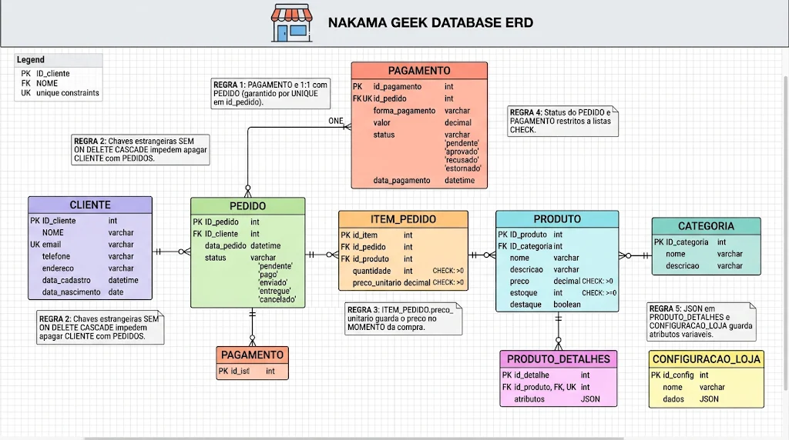

# 🏪 Nakama Geek — Banco de Dados

Banco de dados de uma **loja de mangás e produtos geek**, feito em **MariaDB** para a disciplina de **Banco de Dados**, com o professor **Gabriel Carvalho**.

O projeto cobre o ciclo completo de um banco relacional: modelagem (DER), criação das tabelas, inserção de dados, consultas, joins, alterações de estrutura, JSON, transações e exclusão de objetos.

## 📌 Sobre o projeto

A Nakama Geek vende mangás, action figures, camisetas, colecionáveis e pôsteres. O banco guarda:

- **Clientes** e seus dados de cadastro
- **Produtos**, organizados por **categoria**, com preço e estoque
- **Pedidos** feitos pelos clientes e os **itens** de cada pedido
- **Pagamentos** de cada pedido (Pix, cartão, boleto)
- **Atributos extras em JSON**, como autor e editora do mangá ou os tamanhos de uma camiseta

## 🗂️ Modelo do banco (DER)

| Tabela | O que guarda |
|---|---|
| `CLIENTE` | Quem compra na loja (email único) |
| `CATEGORIA` | Grupos de produtos (mangás, figures, camisetas...) |
| `PRODUTO` | Itens à venda, com preço, estoque e destaque |
| `PEDIDO` | Compra feita por um cliente, com status |
| `ITEM_PEDIDO` | Produtos de cada pedido (resolve a relação N:N) |
| `PAGAMENTO` | Pagamento do pedido (relação 1:1) |
| `PRODUTO_DETALHES` | Atributos variáveis do produto em JSON |
| `CONFIGURACAO_LOJA` | Configurações da loja em JSON |

## 🧠 Decisões de modelagem

1. **Modelo normalizado**: uma tabela por entidade, sem dados repetidos.
2. **`ITEM_PEDIDO` como tabela associativa**: um pedido tem vários produtos e um produto aparece em vários pedidos.
3. **Preço no momento da compra**: `ITEM_PEDIDO.preco_unitario` guarda o preço da venda, então reajustes futuros não alteram o histórico.
4. **Pagamento 1:1 com pedido**, garantido por `UNIQUE` em `id_pedido`.
5. **Integridade no próprio banco**: `NOT NULL`, `UNIQUE`, `DEFAULT` e `CHECK` (preço > 0, estoque ≥ 0, status dentro de uma lista).
6. **Chaves estrangeiras sem `ON DELETE CASCADE`**: o banco impede apagar um cliente que tem pedidos, protegendo o histórico de vendas.
7. **`DECIMAL(10,2)` para dinheiro**, evitando erros de arredondamento.
8. **JSON em tabelas separadas** para atributos que mudam de produto para produto.
9. **Transações** para a venda completa: criar pedido, item, baixar estoque e registrar pagamento. Ou tudo vale (`COMMIT`) ou nada vale (`ROLLBACK`).

## 📚 Conteúdo trabalhado

| Parte | Tema |
|---|---|
| 3 | `CREATE DATABASE` e `CREATE TABLE` |
| 4 | `INSERT` |
| 5 | `SELECT` com `WHERE`, `ORDER BY`, `LIKE`, `BETWEEN`, `IN`, `GROUP BY` |
| 6 | `INNER JOIN` e `LEFT JOIN` (até 4 tabelas) |
| 7 | `ALTER TABLE` (`ADD`, `MODIFY`, `CHANGE`, `DROP`) |
| 8 | `UPDATE` e `DELETE` |
| 9 | JSON (`JSON_EXTRACT`, `JSON_SET`, `JSON_UNQUOTE`, `JSON_VALID`) |
| 10 | Transações (`START TRANSACTION`, `COMMIT`, `ROLLBACK`) |
| 11 | `DROP TABLE` e `DROP DATABASE` |

## 🛠️ Tecnologias

- **MariaDB**
- **DBeaver** (cliente SQL)

## 📂 Arquivos

| Arquivo | Descrição |
|---|---|
| [`codigo_comentad.sql`](codigo_comentad.sql) | Script principal, comentado, com todas as partes da atividade |
| [`BD3.sql`](BD3.sql) | Dump (backup) do banco `nakama_geek` |
| `8446bb8e-...webp` | Diagrama entidade-relacionamento |

## ▶️ Como executar

1. Instale o **MariaDB** e o **DBeaver**.
2. Conecte o DBeaver ao seu servidor MariaDB.
3. Abra o arquivo `codigo_comentad.sql`.
4. Execute o script inteiro com **Alt+X**.

O script recria o banco do zero, então pode ser executado quantas vezes quiser. No final, a conferência deve mostrar:

| Tabela | Registros |
|---|---|
| CATEGORIA | 5 |
| CLIENTE | 10 |
| PRODUTO | 12 |
| PEDIDO | 11 |
| ITEM_PEDIDO | 16 |
| PAGAMENTO | 10 |

> As linhas comentadas com `DELETE` / `DROP` no script são testes de erro de integridade. Rode-as manualmente apenas se quiser ver o banco bloqueando a operação.

## 👨‍🏫 Professor

**Gabriel Carvalho** — Banco de Dados

## 👤 Autor

**Allan**
